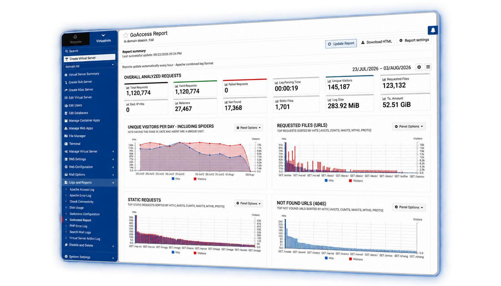

# virtualmin-goaccess

A Virtualmin plugin that builds interactive [GoAccess](https://goaccess.io/)
reports for Apache and Nginx websites.

<p align="center">
  <picture>
    <source media="(prefers-color-scheme: dark)" srcset="docs/images/hero-dark.png">
    
  </picture>
</p>

## Requirements

- Webmin 2.670 or later with Virtualmin 8.2 or later
- GoAccess 1.7 or later

The module packages recommend these distribution packages:

| Distribution | Packages | GoAccess path |
| --- | --- | --- |
| AlmaLinux and Rocky Linux | `goaccess` from EPEL, `geolite2-country` from AppStream | `/usr/bin/goaccess` |
| Debian and Ubuntu | `goaccess` | `/usr/bin/goaccess` |

GoAccess installs its required libraries through the package manager. FreeBSD
defaults to `/usr/local/bin/goaccess`.

## Usage

Enable **GoAccess reporting** in **System Settings → Features and Plugins**, then
enable it for a virtual server. Open the report under
**Logs and Reports → GoAccess Report**. Reports update on a schedule or on demand.
Use **GoAccess Configuration** to set the log format, schedule and filters.

Referrers from the website's own hostnames and configured aliases are hidden by
default. Their requests still count toward page views, visitors and bandwidth.
Disabling the filter includes local referrers again after the next report update.
The filter covers the first 32 distinct DNS names or wildcard subdomains.
GoAccess allows 64 referrer filters, and each name needs two to match referrers
with and without an explicit port.
Reports still update if the website has more names, but warn that some local
referrers may appear.

Users with permission to read the website's access log can search individual
requests.

To enable reporting for a virtual server from the command line, run as root:

```sh
virtualmin enable-feature --domain example.com --virtualmin-goaccess
```

Requests that return HTTP 404 count as missing URLs and are excluded from the
lists of requested pages and static files. A URL can appear as both missing and
requested if some requests returned another status. An error page served with
HTTP 200 counts as a normal request.

### GeoIP databases

New installations on AlmaLinux and Rocky Linux 8 or later use
`/usr/share/GeoIP/GeoLite2-Country.mmdb` from `geolite2-country` by default.
Webmin selects the matching OS/version config file and preserves saved settings
during upgrades, including blank database paths. The packaged Country database
may be outdated. Use an updated database for current location data.

Debian and Ubuntu start with GeoIP disabled. Their `geoip-database` package
contains legacy `.dat` files that cannot be used by this module's GeoIP2 support.
Install compatible `.mmdb` databases separately. City and ASN databases are
optional on all distributions.

Set the full paths to installed MaxMind GeoIP2 or GeoLite2 `.mmdb` databases to
include visitor location and network details in reports. A City database provides
country and city details and takes precedence over a Country database. A Country
database provides country details only. An optional GeoLite2 ASN database adds
network numbers and organizations. Leaving all database paths blank disables
GeoIP lookups.

City details are listed for individual visitor IP addresses. IP anonymization
can make these details less accurate or unavailable.

GeoIP reporting requires GoAccess 1.7 or later built with GeoIP2 support. Check
for `--enable-geoip=mmdb` in `goaccess --version`. Each domain owner must be able
to read the database files and access their parent directories. Download and
update the databases separately. Changes apply to the next report update.
The module ignores the global `goaccess.conf` file.

Saving module settings checks that GoAccess supports GeoIP2 and can open the
active databases. Invalid settings are rejected. Validating a virtual server
also checks database access as its owner. A Country database is not checked
while a City database is configured.

These GeoIP checks do not run when viewing reports or enabling reporting. If a
report update fails, the previous report remains available and the error is shown.

## Tests

```sh
prove t/report.t
node t/report-sync.js
node t/report-tooltips.js
```

Test OS-specific defaults and upgrade preservation with Webmin's config installer:

```sh
perl t/config.pl /path/to/webmin
```

On a disposable Linux VM with GoAccess installed, add `--live` and run as root
to generate a report as `nobody` using the distribution defaults. This also
checks access to the configured Country database. It does not change installed
module settings or reports.

On a disposable test VM, `t/parser.pl` tests real report generation with
MaxMind's public `GeoIP2-City-Test.mmdb`, `GeoIP2-Country-Test.mmdb` and
`GeoLite2-ASN-Test.mmdb` files from the
[MaxMind-DB test data](https://github.com/maxmind/MaxMind-DB/tree/main/test-data).
Pass the GoAccess executable and database directory:

```sh
perl t/parser.pl /usr/bin/goaccess /tmp/geoip-test-databases
```

On a disposable Virtualmin test VM, run `t/usability.pl` as root from the
installed module directory. Use an existing test domain named
`ga-test-<lowercase hex digits>.example.test` with GoAccess reporting enabled.
The default report schedule must be hourly or daily.

This test replaces the domain's GoAccess settings, generated report and access
log, and leaves report updates set to manual. It checks that GeoIP errors do not
block setup and that successful scheduled updates do not send cron mail when
some local referrers remain visible.

Set `WEBMIN_CONFIG` and `WEBMIN_VAR` to Webmin's configuration and data directories:

```sh
WEBMIN_CONFIG=/etc/webmin WEBMIN_VAR=/var/webmin \
  perl t/usability.pl ga-test-01234567.example.test
```

## License

GPL-3.0; see [LICENSE](LICENSE).
